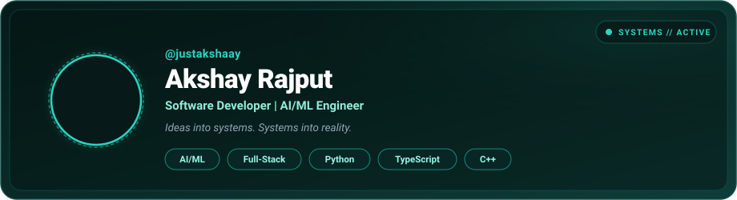
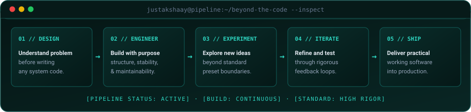

AN EDITORIAL PROFILE · JUSTAKSHAAY

<!-- Hero Identity Card -->

  

<!-- Monospace Terminal Banner -->

  

  <strong>Software Developer | AI/ML Engineer</strong> · Delhi

  <em>Ideas into systems. Systems into reality.</em>

  I build software at the intersection of engineering, intelligence, and creativity. My work spans full-stack applications, machine learning models, intelligent systems, and end-to-end software development. I enjoy taking ideas beyond the conceptual stage and turning them into functional, practical solutions.

  <a href="https://github.com/justakshaay">GitHub</a> ·
  <a href="https://www.linkedin.com/in/akshay-kumar-2472b6381/">LinkedIn</a> ·
  <a href="https://www.instagram.com/justakshaay">Instagram</a> ·
  <a href="mailto:akshaykkumar2006@gmail.com">Email</a>

──────── ◇ ────────

<!-- The Point of View & Profile Snapshot -->
<table>
  <tr>
    <td width="55%" valign="top">
      <h3>The point of view</h3>
      <blockquote><em>"Building things that work. Engineering things that matter."</em></blockquote>
      <ul>
        <li>Building practical solutions to real-world problems.</li>
        <li>Turning concepts into functional software.</li>
        <li>Combining software engineering with artificial intelligence.</li>
        <li>Experimenting, engineering, testing, and shipping products.</li>
      </ul>
    </td>
    <td width="45%" valign="top">
      
<code>PROFILE</code>

      

        <strong>ROLE</strong> · Software Developer | AI/ML Engineer 
        <strong>BASED</strong> · Delhi 
        <strong>FOCUS</strong> · AI/ML, Full-Stack Systems &amp; End-to-End Products
      

      

        <strong>9</strong> public repos 
        <strong>77+</strong> contributions 
        <strong>3</strong> followers
      

      

        
        
      

    </td>
  </tr>
</table>

──────── ◇ ────────

<!-- Engineering Focus -->
## In the current cut

  

  The ideas, experiments, and decisions moving the work forward.

──────── ◇ ────────

<!-- Production Palette / Tech Stack -->
## Production palette

| Category | Tools &amp; Technologies |
| :--- | :--- |
| **Programming** |       |
| **AI &amp; Data** |     |
| **Development Tools** |      |

  Python · TypeScript · C++ · Jupyter · HTML5 · CSS3 · Git · Linux · tools chosen for the work, not the trend

──────── ◇ ────────

<!-- Featured Projects Reel -->
## Featured reel

<table width="100%">
  <tr>
    <td width="50%" valign="top">
      <code>AI · Intelligent Systems · Aerospace</code>
      <h3><a href="https://github.com/justakshaay/NAVIS-Networked-Adaptive-Visual-Intelligent-Space-Navigation-Sounds-like-a-real-aerospace-system">NAVIS ↗</a></h3>
      
An intelligent satellite-coordination and navigation system designed to support planetary rover operations in GPS-denied environments through adaptive satellite allocation for positioning, navigation, imaging, and communication.

      

        
        
        
      

      

        <a href="https://github.com/justakshaay/NAVIS-Networked-Adaptive-Visual-Intelligent-Space-Navigation-Sounds-like-a-real-aerospace-system"><strong>📂 View Repository</strong></a>
      

    </td>
    <td width="50%" valign="top">
      <code>Full-Stack · FinTech</code>
      <h3><a href="https://github.com/justakshaay/walletsync">WalletSync ↗</a></h3>
      
A personal finance management web application focused on expense tracking, financial organization, and a unified view of personal finances with cash flow tracking across multiple accounts and intelligent habit tagging.

      

        
        
        
      

      

        <a href="https://github.com/justakshaay/walletsync"><strong>📂 View Repository</strong></a>
      

    </td>
  </tr>
  <tr>
    <td width="50%" valign="top">
      <code>C++ · Data Structures · Binary Trees</code>
      <h3><a href="https://github.com/justakshaay/hierarchy-explorer">Hierarchy Explorer ↗</a></h3>
      
A system for exploring organizational and family hierarchies using binary trees, tree operations, and preorder, inorder, and postorder traversal algorithms, deployed with an interactive visual interface.

      

        
        
        
      

      

        <a href="https://github.com/justakshaay/hierarchy-explorer"><strong>📂 View Repository</strong></a> ·
        <a href="https://hierarchy-explorer-nine.vercel.app"><strong>🚀 Live Demo</strong></a>
      

    </td>
    <td width="50%" valign="top">
      <code>Security · Application Development</code>
      <h3><a href="https://github.com/justakshaay/PassForge">PassForge ↗</a></h3>
      
A Python password utility focused on password strength evaluation and security validation using multi-factor entropy checks, pattern detection, and hidden secure input handling.

      

        
        
        
      

      

        <a href="https://github.com/justakshaay/PassForge"><strong>📂 View Repository</strong></a>
      

    </td>
  </tr>
  <tr>
    <td width="50%" valign="top">
      <code>Utilities · Automation</code>
      <h3><a href="https://github.com/justakshaay/TubeVault">TubeVault ↗</a></h3>
      
A media utility designed to simplify video-related download and audio extraction workflows with clean automated local storage handling.

      

        
        
        
      

      

        <a href="https://github.com/justakshaay/TubeVault"><strong>📂 View Repository</strong></a>
      

    </td>
    <td width="50%" valign="top">
      <code>Python · ML · Data Science</code>
      <h3><a href="https://github.com/justakshaay/MachineLearning">Machine Learning ↗</a></h3>
      
A collection of machine learning experiments, implementations, notebooks, and data-driven explorations focusing on pattern discovery, algorithm benchmarks, and predictive model training.

      

        
        
        
      

      

        <a href="https://github.com/justakshaay/MachineLearning"><strong>📂 View Repository</strong></a>
      

    </td>
  </tr>
</table>

  6 featured systems · 9 public repositories · Open-source builds

──────── ◇ ────────

<!-- Under the Hood / GitHub Statistics -->
## Under the hood

  
  

  

  

  Contribution trail · Real-time activity telemetry

──────── ◇ ────────

<!-- Beyond the Code -->
## Beyond the code

  

<blockquote>
  
<strong>DESIGN</strong> — Understand the problem before building. 
  <strong>ENGINEER</strong> — Build systems with purpose and structure. 
  <strong>EXPERIMENT</strong> — Explore ideas beyond conventional solutions. 
  <strong>ITERATE</strong> — Improve through testing and feedback. 
  <strong>SHIP</strong> — Turn working ideas into real products.

</blockquote>

──────── ◇ ────────

<!-- The Next Scene / Connect -->

THE NEXT SCENE

<h2 align="center">Keep the story moving.</h2>

  I build, experiment, and turn ideas into working systems. I'm always interested in ambitious ideas, meaningful collaborations, technical discussions, and connecting with people who enjoy creating things that matter.

  <code>BUILD TOGETHER · EXCHANGE IDEAS · CREATE SOMETHING USEFUL</code>

  
  
  
  

